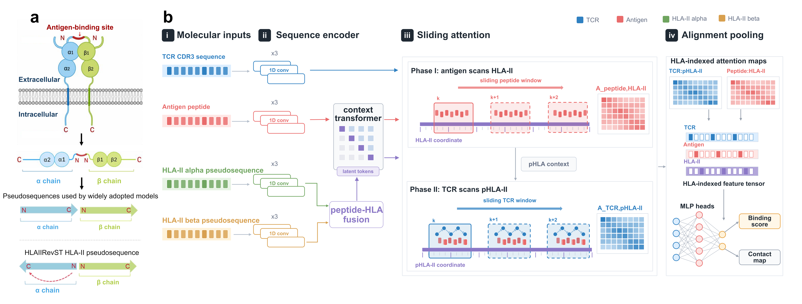

# HLAIIRevST

**Dual-chain HLA-II–peptide–TCR recognition with two-stage sliding attention**

HLAIIRevST predicts HLA-II-restricted ternary recognition from an antigen peptide, HLA-II α and β pseudosequences, and a TCR CDR3 sequence. It supports molecular-level candidate prioritisation for experimental assessment of therapeutic antibody immunogenicity. Scores are not calibrated probabilities of patient anti-drug antibody (ADA) formation.

## Model overview

The model independently encodes four sequence inputs, fuses the two HLA-II chains, and connects peptide–HLA-II interaction to TCR–pHLA-II recognition through two-stage sliding attention. Alignment decoding and pooling feed a binary classifier.

- **Explicit dual-chain encoding:** 15 α-chain and 19 β-chain positions form a 34-position HLA-II representation.
- **Orientation-aware inputs:** four α/β reading-order combinations test the α-reverse, β-forward representation.
- **Parameter-efficient adaptation:** LoRA supports transfer of compatible HLA-I backbone weights to HLA-II.

## Main files

| File or directory | Purpose |
|---|---|
| `code/main.py` / `code/HLAIIRevST.sh` | Fine-tuning / reference training configuration |
| `code/predict_hlaiirevst.py` | Prediction for labelled or unlabelled CSV inputs |
| `code/test.py` / `code/run` | Fixed-checkpoint evaluation / Bash wrapper |
| `code/Model/` / `code/Dataset/` | Model components / data loading |
| `code/checkpoints/` | Base and fine-tuned model weights |
| `data/hlaii/` | Orientation-specific training, validation and test splits |

## Installation

The reference environment uses Python 3.7.12, PyTorch 1.10.2 and CUDA 11.3.1. From the repository root:

~~~bash
conda env create --name HLAIIRevST --file code/HLAIIRevST.yml
conda activate HLAIIRevST
~~~

The YAML is a platform-specific Linux export. Use a compatible Linux/WSL environment for the Bash examples. Prediction and evaluation support CPU; GPU execution requires a compatible CUDA installation. Newer PyTorch versions may require checkpoint-loading compatibility adjustments.

## Input format

| Column | Content | Maximum length |
|---|---|---:|
| `HLA_alpha` | HLA-II α pseudosequence | 15 |
| `HLA_beta` | HLA-II β pseudosequence | 19 |
| `MT_pep` | Antigen peptide | 25 |
| `CDR3` | TCR CDR3 sequence | 30 |
| `label` | 0/1 recognition label; optional for prediction | — |

`HLA_type` and `peplen` provide allele and peptide-length metadata. Use `--peptide_col` for another peptide column name. Example:

~~~csv
CDR3,HLA_type,MT_pep,HLA_alpha,HLA_beta,label,peplen
SARDLTSGANNEQF,DRB1_1501,ENPVVHFFKNIVTPR,MIADVAAGSAIFFEQ,WPRFDYFDIQAATYHVVFT,1,15
~~~

**Prepare pseudosequences in the checkpoint's orientation before prediction or evaluation; the entry points do not reverse them automatically.** The supplied OE2 models use α-reverse / β-forward inputs. Allele names alone cannot replace the sequence columns. Validate uppercase residues and sequence lengths before prediction.

The dataset contains 13,079 training samples (1,282 positives), 3,270 validation samples (321 positives), and 223 independent-test samples (20 positives).

## Checkpoints

Two OE2 checkpoints are under `code/checkpoints/hlaii_lora/seed_20220909/`:

| Role | Selection | Filename ending |
|---|---|---|
| **Val-AUPR primary** | Maximum validation AUPR, epoch 182 | `best_val_aupr_epoch182_AUPR0p702435.pkl` |
| **Test-PPVn exploratory** | Maximum test PPVn, epoch 121 | `best_test1_ppvn_epoch121_PPVN0p550000.pkl` |

Use the primary model for the main evaluation. Test-label-based selection makes the exploratory model suitable for sensitivity analysis, not unbiased test-performance estimation. The base checkpoint is transfer initialisation, not the final HLA-II model.

## Quick start

Run the following in one Bash session, starting from the repository root. The first command defines the complete primary checkpoint path:

~~~bash
cd code
PRIMARY_CKPT="checkpoints/hlaii_lora/seed_20220909/3_lora_full_r8_frac-100_none_core-full_alpha_reverse_best_val_aupr_epoch182_AUPR0p702435.pkl"
~~~

### Prediction

Try the supplied test input, or replace `--input` with your own CSV:

~~~bash
python predict_hlaiirevst.py \
  --input "../data/hlaii/test_data(-).csv" \
  --checkpoint "$PRIMARY_CKPT" \
  --output "outputs/prediction" --device cpu --num_workers 0
~~~

The default output, `outputs/prediction/hlaiirevst_predictions.csv`, preserves input columns and adds `predicted_score`, `predicted_label` and `decision_threshold`. Unlabelled inputs are supported. Use `--device auto` for automatic device selection.

### Evaluation

From the same `code/` session:

~~~bash
python test.py \
  --input "../data/hlaii/test_data(-).csv" \
  --checkpoint "$PRIMARY_CKPT" \
  --output "outputs/primary_test" --device cpu --num_workers 0
~~~

Outputs are `hlaiirevst_test_predictions.csv` and `hlaiirevst_test_metrics.json` under `outputs/primary_test/`. Metrics include AUROC, trapezoidal AUPR, PPVn, accuracy and confusion-matrix counts. AUPR differs from stepwise AP. PPVn is precision among the top N scores, with N equal to the evaluation set's positive count.

Classification uses **score > threshold**. Threshold priority is `--threshold`, checkpoint metadata, then 0.5.

### Training

From `code/`, check the environment and files before starting the reference GPU workflow:

~~~bash
bash HLAIIRevST.sh --check
bash HLAIIRevST.sh
~~~

The reference configuration uses α-reverse / β-forward inputs, seed 20220909, 200 epochs, batch size 256, Adam at 1 × 10⁻⁴, and rank-8 LoRA. The launcher creates a background job. It refuses to start while `check_out3.txt` or `check_err3.log` exists; archive the supplied logs and preserve existing checkpoints before a new run.

More options: `python main.py --help`. The reference settings are defined in `code/HLAIIRevST.sh`. Training uses the complete training split; the unused `--train_fraction` and `--train_subset_seed` compatibility options have been removed.

The compatibility cleanup retains checkpoint keys, initialization order and original gradient flags. Parameters disconnected from the classification loss, including native `MultiheadAttention.out_proj` LoRA tensors, remain in the model but are excluded from the optimizer. Parameter counts printed as `Optimizer params` describe that filtered list. Interaction feed-forward blocks retain their original per-forward affine LayerNorm and attention score cloning to preserve the original autograd path. The binary reverse branch and intermediate ternary reverse branches remain active.

## Reported results

Manuscript point estimates on the independent test set, after validation-AUPR checkpoint selection:

| Orientation | AUROC | AUPR | PPVn |
|---|---:|---:|---:|
| OE1: α-forward / β-forward | 0.804 | 0.344 | 0.350 |
| **OE2: α-reverse / β-forward** | **0.874** | **0.441** | **0.350** |
| OE3: α-forward / β-reverse | 0.770 | 0.279 | 0.250 |
| OE4: α-reverse / β-reverse | 0.767 | 0.205 | 0.250 |

OE2 had the highest AUPR point estimate; the paired-bootstrap OE2−OE1 difference was +0.097 (95% interval −0.053 to +0.249). Only the two OE2 checkpoints are included in this snapshot.

## Software checks

From the repository root:

~~~bash
python -B -m unittest discover -s code/tests -v
~~~

The snapshot includes core training, prediction and evaluation code, datasets and checkpoints. Some manuscript figure-generation and comparison-model assets are outside this snapshot.

## Manuscript, attribution and contact

**Jie Zhu, Bowen Duan and Haifeng Chen.** *HLAIIRevST: a Therapeutic Antibody Immunogenicity Prediction Model Based on a Sliding-attention Framework.*

The two-stage sliding-attention and alignment framework builds on PISTE:

- Feng Z et al. Sliding-attention transformer neural architecture for predicting T cell receptor–antigen–human leucocyte antigen binding. *Nature Machine Intelligence* **6**, 1216–1230 (2024).

**Contact:** Haifeng Chen, Shanghai Jiao Tong University — haifengchen@sjtu.edu.cn.
